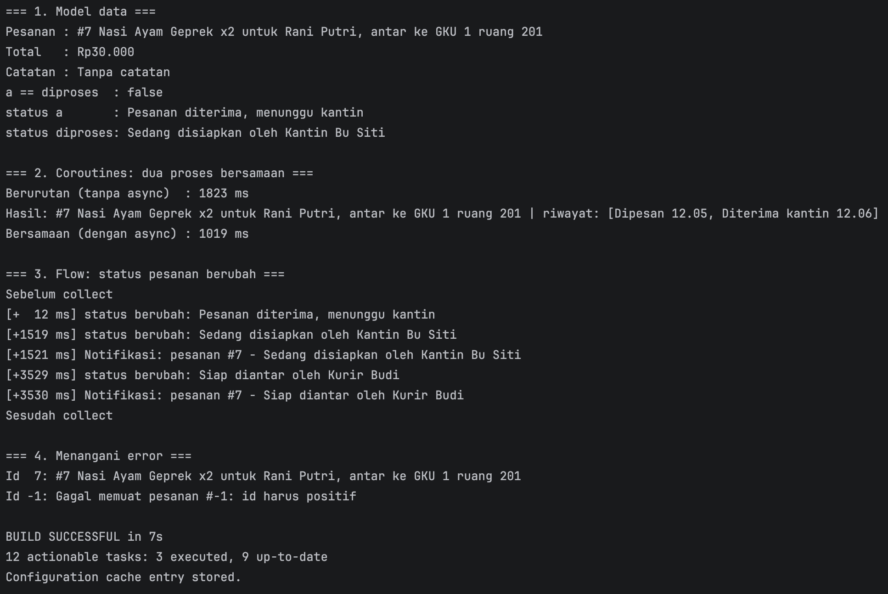

# Pesan Antar Makanan Kantin

Proyek kelompok mata kuliah **Pengembangan Aplikasi Mobile (IF25-22017)**, Teknik Informatika ITERA, dibuat dengan **Kotlin Multiplatform + Compose Multiplatform**.

## Tema
**Pesan Antar Makanan Kantin** – aplikasi untuk memesan makanan dari kantin kampus dan mengantarkannya ke pemesan.
Fitur platform yang dipakai: **Notifikasi** (pemberitahuan pesanan diterima, diproses, dan siap diantar).

## Anggota Kelompok
| No | Nama | NIM |
|----|------|-----|
| 1 | Muhammad Faiz Ashfaq | 124140144 |
| 2 | Aryo Fajar Pratomo   | 124140012 |
| 3 | Syehabudin           | 124140102 |

## Progres
### Minggu 1 (proyek ada di folder `Modul 1`)
- [x] Proyek dibuat dari template Compose Multiplatform dan di-push ke repository kelompok
- [x] Judul aplikasi diganti menjadi nama tema, nama platform ikut tampil
- [x] Setiap anggota menambahkan nama dan NIM di layar Tentang (satu commit per anggota)

Folder `Modul 2` melanjutkan tema yang sama dan fokus pada model data, coroutines, dan Flow.

### Minggu 2: Model Data, Coroutines, dan Flow
- [x] **Model data tema**: dua data class (`Pesanan`, `MenuKantin`) dan satu sealed class status (`StatusPesanan`) di `commonMain/model`
- [x] **Sumber data palsu**: `SumberPesananPalsu` mengimplementasikan `Sumber<Pesanan>` dengan `delay` dan Flow perubahan status
- [x] **Bukti berjalan**: `jalankanDemo()` mencetak model, hasil coroutines, perubahan status lewat Flow, dan penanganan error ke konsol

## Model Data (Minggu 2)

Kode model, data, dan demo ada di `commonMain`, jadi dipakai bersama oleh Android dan Desktop. Hanya titik masuk `DemoMain.kt` yang diletakkan di `jvmMain` agar bisa dijalankan sebagai program konsol di desktop.

| Tipe | Jenis | Isi |
|------|-------|-----|
| `Pesanan` | data class (entitas utama) | `id: Int`, `pemesan: String`, `lokasiAntar: String`, `menu: MenuKantin`, `jumlah: Int`, `catatan: String?`, `status: StatusPesanan = Diterima` |
| `MenuKantin` | data class (entitas pendukung) | `id: Int`, `nama: String`, `kantin: String`, `harga: Int` |
| `StatusPesanan` | sealed class | `Diterima` (data object), `Diproses(penjual)`, `SiapDiantar(kurir)` |

Keputusan desain:
- **Sealed class untuk status**, bukan `String`. Statusnya hanya tiga kemungkinan dan sebagian membawa data sendiri (siapa penjualnya, siapa kurirnya). Dengan `when`, compiler memeriksa semua kemungkinan; kalau nanti ada status baru, setiap `when` yang belum menanganinya langsung ditandai. Dengan `String`, salah ketik seperti `"Diporses"` baru ketahuan saat aplikasi jalan.
- **Semua properti `val`**. Pesanan tidak diubah di tempat, tetapi disalin dengan nilai baru lewat `copy` (`pesanan.copy(status = ...)`).
- **Hanya `catatan` yang nullable**, karena pemesan boleh tidak menulis catatan. Kolom lain wajib ada. Di kode, `catatan` ditangani dengan `?:` (`catatanAtauDefault()`).
- **Extension function** (`label()`, `total()`, `ringkas()`, `rupiah()`) menempelkan kemampuan ke tipe tanpa mengubah class-nya.

## Sumber Data Palsu (Minggu 2)

`Sumber<T>` adalah satu kontrak untuk semua sumber data:

```kotlin
interface Sumber<T> {
    suspend fun ambil(id: Int): T      // satu nilai, sekali
    fun pantau(id: Int): Flow<T>       // banyak nilai dari waktu ke waktu
}
```

`SumberPesananPalsu : Sumber<Pesanan>` meniru server:
- `ambil(id)` menunggu 1000 ms (`delay`), lalu mengembalikan satu pesanan.
- `ambilRiwayat(id)` menunggu 800 ms, dipakai untuk latihan `async`.
- `pantau(id)` memancarkan pesanan yang sama tiga kali: **Diterima**, setelah 1500 ms **Diproses**, setelah 2000 ms lagi **SiapDiantar**.

`muatAman(id)` adalah extension function pada `Sumber<Pesanan>` di `data/MuatAman.kt`: ia memuat pesanan dengan `try/catch`, dan `CancellationException` dilempar ulang supaya pembatalan coroutine tidak tertelan.

Minggu 6 cukup menulis `SumberPesananServer : Sumber<Pesanan>` tanpa mengubah pemanggilnya.

## Contoh Keluaran Konsol

Keluaran asli dari `jalankanDemo()` (angka milidetik bisa berbeda tipis di tiap komputer):

```
=== 1. Model data ===
Pesanan : #7 Nasi Ayam Geprek x2 untuk Rani Putri, antar ke GKU 1 ruang 201
Total   : Rp30.000
Catatan : Tanpa catatan
a == diproses  : false
status a       : Pesanan diterima, menunggu kantin
status diproses: Sedang disiapkan oleh Kantin Bu Siti

=== 2. Coroutines: dua proses bersamaan ===
Berurutan (tanpa async)  : 1823 ms
Hasil: #7 Nasi Ayam Geprek x2 untuk Rani Putri, antar ke GKU 1 ruang 201 | riwayat: [Dipesan 12.05, Diterima kantin 12.06]
Bersamaan (dengan async) : 1019 ms

=== 3. Flow: status pesanan berubah ===
Sebelum collect
[+  12 ms] status berubah: Pesanan diterima, menunggu kantin
[+1519 ms] status berubah: Sedang disiapkan oleh Kantin Bu Siti
[+1521 ms] Notifikasi: pesanan #7 - Sedang disiapkan oleh Kantin Bu Siti
[+3529 ms] status berubah: Siap diantar oleh Kurir Budi
[+3530 ms] Notifikasi: pesanan #7 - Siap diantar oleh Kurir Budi
Sesudah collect

=== 4. Menangani error ===
Id  7: #7 Nasi Ayam Geprek x2 untuk Rani Putri, antar ke GKU 1 ruang 201
Id -1: Gagal memuat pesanan #-1: id harus positif
```

Tangkapan layar hasil yang sama (termasuk status build Gradle):



Cara membaca hasilnya:
- **Bagian 1**: `copy` membuat pesanan baru; pesanan `a` tetap berstatus Diterima (`a == diproses` bernilai `false`).
- **Bagian 2**: `ambil` (1000 ms) dan `ambilRiwayat` (800 ms) dijalankan berurutan butuh sekitar 1800 ms. Dengan dua `async`, keduanya menunggu bersamaan sehingga total sekitar 1000 ms, yaitu waktu proses yang paling lama.
- **Bagian 3**: Flow baru mengalir setelah `collect` dipanggil. Baris `Sesudah collect` tercetak paling akhir karena `collect` ikut menunggu sampai Flow selesai. Status `Diterima` dibuang oleh `filter`, jadi notifikasi hanya muncul untuk Diproses dan SiapDiantar. Inilah dasar fitur **Notifikasi** tema kami.
- **Bagian 4**: id tidak valid ditangkap `try/catch` dan menjadi pesan, aplikasi tidak crash.

## Struktur Berkas (tambahan Minggu 2)

```
shared/src/
├── commonMain/kotlin/com/example/modul2/
│   ├── model/
│   │   ├── MenuKantin.kt        data class pendukung
│   │   ├── Pesanan.kt           data class utama
│   │   ├── StatusPesanan.kt     sealed class status
│   │   └── PesananExt.kt        extension: label, total, ringkas, rupiah
│   ├── data/
│   │   ├── Sumber.kt            interface Sumber<T>
│   │   ├── ContohData.kt        data contoh
│   │   ├── SumberPesananPalsu.kt  delay + Flow perubahan status
│   │   └── MuatAman.kt          try/catch untuk suspend function
│   └── demo/
│       └── DemoKonsol.kt        jalankanDemo(): bukti berjalan
└── jvmMain/kotlin/com/example/modul2/
    └── DemoMain.kt              titik masuk demo di desktop (JVM)
```

## Pembagian Tugas

| Anggota              | Bagian yang dikerjakan | Berkas |
|----------------------|------------------------|--------|
| Aryo Fajar Pratomo   | Model data tema | `model/*` |
| Syehabudin           | Sumber data palsu: `delay`, Flow, error | `data/*` |
| Muhammad Faiz Ashfaq | Bukti berjalan di konsol dan README | `demo/DemoKonsol.kt`, `DemoMain.kt`, `README.md` |

## Cara Menjalankan
- **Android**: buka proyek di Android Studio, pilih konfigurasi `androidApp`, lalu Run.
- **Desktop (aplikasi)**: `./gradlew :desktopApp:run` (Windows: `gradlew.bat :desktopApp:run`).
- **Demo konsol (bukti berjalan)**: jalankan `./gradlew :shared:runDemo` atau buka `shared/src/jvmMain/kotlin/com/example/modul2/DemoMain.kt`, klik ikon Run hijau di sebelah `fun main`, lalu lihat keluarannya di jendela Run. Demo berjalan sekitar 7 detik.

### Dependensi coroutines
Kode demo memakai `kotlinx-coroutines-core`. Di proyek ini coroutines sudah ikut tersedia lewat dependensi Compose/lifecycle, tetapi sebaiknya dideklarasikan eksplisit di `commonMain`.

`gradle/libs.versions.toml` sudah punya entri versi `kotlinx-coroutines = "1.11.0"`, tetapi alias library-nya belum ada. Tambahkan:
```toml
[libraries]
kotlinx-coroutines-core = { module = "org.jetbrains.kotlinx:kotlinx-coroutines-core", version.ref = "kotlinx-coroutines" }
```

`shared/build.gradle.kts`:
```kotlin
kotlin {
    sourceSets {
        commonMain.dependencies {
            // ... dependensi bawaan template
            implementation(libs.kotlinx.coroutines.core)
        }
    }
}
```

Semua berkas memakai package `com.example.modul2`: model di `com.example.modul2.model`, data di `com.example.modul2.data`, dan demo di `com.example.modul2.demo`. `mainClass` task `runDemo` di `shared/build.gradle.kts` juga sudah mengarah ke `com.example.modul2.DemoMain`.
